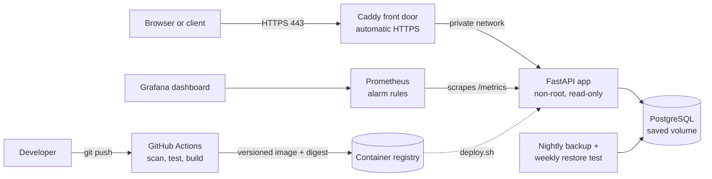

# Bus Booking Platform - a service that proves its own reliability

> **Break it. Watch it recover. Keep the evidence.**
> A small bus trip & seat reservation API, wrapped in the engineering that makes it safe to run:
> reproducible containers, an automated pipeline, an HTTPS front door, monitoring with an alarm,
> tested backups, health-gated releases with automatic rollback - and a one-command **proof drill**
> that deliberately breaks the system and records that it recovers.

| Submission facts | |
|---|---|
| Repository | [himanshuarora2k5/bus-booking-platform](https://github.com/himanshuarora2k5/bus-booking-platform) |
| Branch / final commit | `main` / See latest commit on GitHub |
| Live demo | Local-only: `https://localhost:8443/docs` (no public cloud server deployed) |
| CI run (green) | [Successful CI run #3](https://github.com/himanshuarora2k5/bus-booking-platform/actions/runs/43710844318) |
| Image tag / digest | `sha-e098876` / See digest in successful CI run summary |
| Drill evidence | [`evidence/LATEST.md`](evidence/LATEST.md) |
| Demo video | Pending recording and upload |

## What is proven (and where)

| Claim | Proof |
|---|---|
| Two people can never hold the same seat, even if 50 click at the same instant | `tests/test_concurrency.py` and drill step 3 (exactly 1 winner, 49 clean `409`, no extra PNR) |
| A conflicting booking creates no PNR | drill step 3 checks the booking count in the database |
| The service notices a dead database and raises an alarm | drill step 5 (`/health/ready` 503, Prometheus `DatabaseDown` firing) |
| It recovers by itself when the database returns | drill step 5 (no app restart needed) |
| Backups are usable, not just present | `scripts/verify_backup.sh` restores into a scratch database and compares data; drill step 6 wipes everything and restores |
| A broken release never stays live | drill step 8 (health gate fails, previous version restored automatically) |
| A crashed container comes back by itself | drill step 9 |
| Builds are repeatable and checked | CI: secret scan, lint, dependency audit, tests, image build, vulnerability scan, SBOM, versioned image + digest |

## Architecture



The Caddy front door is the only published application entry point on the local host. The database has no published port. `/metrics` is blocked at the front door and
only Prometheus (inside the private network) can read it. Prometheus and Grafana are bound to `127.0.0.1`.

## Reproduce it on a clean machine

Requirements: Linux (or WSL on Windows), Docker with Compose, `git`, `curl`, `python3`.

```bash
git clone https://github.com/himanshuarora2k5/bus-booking-platform.git
cd bus-booking-platform
bash scripts/make_env.sh        # creates .env with random passwords (prints the dashboard password)
bash scripts/deploy.sh v1       # builds, starts everything, checks health
```

Then open `https://localhost:8443/docs` (the browser warns about the local certificate: Advanced -> Proceed).
Check everything: `docker compose ps` (all `healthy`), `curl -k https://localhost:8443/health/ready`.
Try a booking by hand: `bash scripts/try_booking.sh 3C` (run it twice: first `201`, then `409`).

Run the tests: `docker compose --profile test run --rm test`
Run the proof drill: `python3 scripts/drill.py` (about 4 minutes; writes `evidence/LATEST.md`).

## Port map

| What | Port | Who can reach it |
|---|---|---|
| Front door (HTTPS) | `HTTPS_PORT` (443 on a server, 8443 locally) | public |
| Front door (HTTP, redirects to HTTPS) | `HTTP_PORT` (80 / 8080) | public |
| API directly | 8000 | this machine only |
| Prometheus | 9090 | this machine only |
| Grafana (login `admin` / `GRAFANA_PASSWORD`) | 3000 | this machine only |
| PostgreSQL | 5432 | other containers only |

## Environment variables (`.env`, never committed)

| Name | Meaning |
|---|---|
| `POSTGRES_USER`, `POSTGRES_PASSWORD`, `POSTGRES_DB` | database login |
| `GRAFANA_PASSWORD` | dashboard login |
| `SITE_ADDRESS` | `localhost` (local certificate) or a public name (real certificate fetched automatically) |
| `HTTP_PORT`, `HTTPS_PORT` | host ports of the front door |
| `APP_IMAGE`, `APP_VERSION` | the live release; written by `deploy.sh`, do not edit by hand |
| `LOG_LEVEL`, `SEED_DEMO_DATA`, `BACKUP_KEEP` | optional tuning |

## API

| Method | Path | Purpose |
|---|---|---|
| GET | `/health/live` | the process is running |
| GET | `/health/ready` | the process **and** the database work (503 otherwise) |
| GET | `/routes` | routes with ordered stops |
| GET | `/trips?origin=&destination=&date=YYYY-MM-DD` | upcoming trips and free seats |
| GET | `/trips/{id}/seats` | seat map |
| POST | `/bookings` | book one or more seats; returns the PNR |
| GET | `/bookings/{pnr}` | booking details |
| POST | `/bookings/{pnr}/cancel` | cancel; frees the seats |

Validation: travel date must match the trip and be in the future; boarding stop must come before the drop stop on that
route; passenger name, age (1-120), gender, seat and a 10-digit Indian mobile number are checked.
Errors look like `{"detail": {"code": "SEAT_ALREADY_BOOKED", "message": "..."}}`.

## The key rule: no double booking

A seat on a trip may have only one **confirmed** ticket. The database enforces it with a partial unique index
(`uq_tickets_confirmed_seat`), so it holds no matter how many requests arrive together. A losing request gets
HTTP 409 and its transaction is rolled back, so **no booking row and no PNR is kept**. Cancelled tickets are ignored
by the index, so a cancelled seat can be booked again.

## Deploy, release and rollback

Always release with the script. It builds the new version, starts it, and checks that **that exact version** answers
`/health/ready`. If it does not within 40 seconds it automatically restores the previous version.

```bash
bash scripts/deploy.sh v2                              # normal release
bash scripts/deploy.sh v3-bad --simulate-bad-release   # demo: shows the automatic rollback
bash scripts/deploy.sh sha-1a2b3c4 --image ghcr.io/himanshuarora2k5/bus-booking-platform:sha-e098876   # use a CI-built image
```

**Manual rollback** (for example if a release passes the health check but behaves badly):
`cat .deploy/history.log` shows earlier versions, then `bash scripts/deploy.sh <earlier-version>` (local images are kept).
Full procedure: [docs/RUNBOOK.md](docs/RUNBOOK.md).

## Backup and restore

```bash
bash scripts/backup.sh                       # compressed dump + SHA-256 fingerprint in backups/
bash scripts/verify_backup.sh                # restores a fresh backup into a scratch DB and compares data
bash scripts/restore.sh backups/<file>.sql.gz   # REPLACES live data (asks you to type YES)
```
For a future server deployment, `bash infra/install-cron.sh` can schedule nightly backups and weekly restore tests. This was not enabled for this local demonstration.

## Observability

- Health: `/health/live` and `/health/ready`; Docker marks the container unhealthy if readiness fails.
- Logs: one JSON object per line (`docker compose logs -f app`), each request has a `request_id`.
- Metrics: request rate, errors, latency, booking outcomes, database-up flag (Prometheus at `:9090`).
- Alarms: `ApiDown`, `DatabaseDown`, `HighServerErrorRate` (rules in `deploy/prometheus/alerts.yml`, each links to a runbook section).
- Dashboard: Grafana at `:3000`, provisioned from `deploy/grafana/` (no clicking required).

## Security

- Image runs as a non-root user, read-only filesystem, all Linux capabilities dropped, `no-new-privileges`.
- Database not published; metrics hidden from the public; secrets only in `.env` (git-ignored) and checked by a secret scanner in CI.
- CI: dependency audit (`pip-audit`), image scan (Trivy, fails on fixable CRITICAL), SBOM published with each run,
  GitHub Actions pinned to exact commit IDs, minimal token permissions.
- Security headers and HTTPS (HSTS) at the front door.

## Repository map

```
app/            the API (FastAPI)            db/        schema.sql, seed.sql
tests/          25 tests, real PostgreSQL    deploy/    Caddyfile, Prometheus, Grafana
scripts/        deploy, backup, restore, verify_backup, drill, make_env, try_booking
infra/          Optional Azure scripts (not deployed)         docs/      runbook, decisions
.github/        CI and manual drill workflows   evidence/  drill reports and screenshots
```

## Known limitations and assumptions

- One server, one database: no high availability. Recovery is automatic restart + restore from backup.
- Backups are stored on the same machine (copy them off-machine for real production use).
- Alerts are visible in Prometheus/Grafana; no email/Slack delivery is configured.
- The API has no user login (out of scope for this assessment); demo data is seeded automatically.
- The schema is created idempotently at start-up; there is no migration tool.
- The local HTTPS certificate is self-signed, so browsers show a certificate warning. No public server or trusted public certificate was deployed for this submission.

## AI assistance disclosure

I used Anthropic's Claude and OpenAI's ChatGPT as AI pair-programming assistants
and tutors for design discussions, drafting, explanations and troubleshooting.
I executed the commands, reviewed outputs, ran the tests and proof drills, and
verified the application's behaviour. Libraries and tools: FastAPI, psycopg,
prometheus-client, PostgreSQL, Caddy, Prometheus, Grafana, Trivy, gitleaks and pip-audit.
